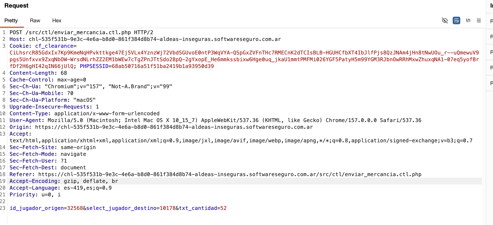
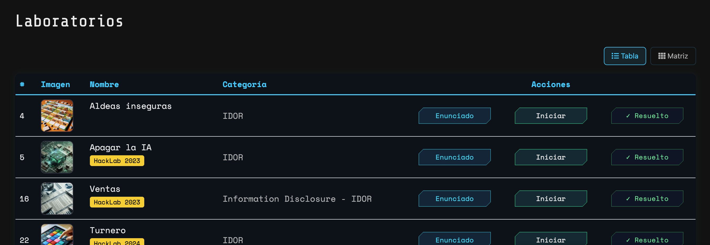

# 🏰 Desafío: Aldeas Inseguras (V1)

> ℹ️ **Nota:** Este desafío es parte del **curso de ciberseguridad pagado por la empresa** en la plataforma [softwareseguro.com.ar](https://app.softwareseguro.com.ar).
> Es la **versión 1** del reto. La [versión 2](../../Desafios/AldeaV2/aldeaReadme.md) (resuelta en el training de GISSIC-UTN) usa UUIDs y tres recursos; esta V1 usa **IDs numéricos** y un **único recurso (monedas)**.

---

### 🧠 Descripción del caso

Aldeas Inseguras es un juego de administración de aldeas medievales. El objetivo del reto es ayudar a **Pedro** a reunir una gran cantidad de **monedas** acumulando recursos desde el resto de las aldeas.

> Mismo juego que la V2 pero con un **único recurso (monedas)**: hay que acumular las monedas de las aldeas vecinas en la aldea de **Pedro** hasta alcanzar el objetivo del reto.

---

### 🔍 Análisis técnico

Al interceptar con **Burp Suite** la solicitud que se genera al enviar recursos a otra aldea, observamos:



```http
POST /src/ctl/enviar_mercancia.ctl.php HTTP/2
Host: chl-535f531b-9e3c-4e6a-b8d0-861f384d8b74-aldeas-inseguras.softwareseguro.com.ar
Cookie: cf_clearance=...; PHPSESSID=68ab50716a51f51ba2419b1a93950d39
Content-Type: application/x-www-form-urlencoded
...

id_jugador_origen=32568&select_jugador_destino=10178&txt_cantidad=52
```

Puntos clave de la petición:

- Los tres parámetros que importan viajan en el `body`: **`id_jugador_origen`**, **`select_jugador_destino`** y **`txt_cantidad`**.
- Los identificadores de jugador son **numéricos** (`32568`, `10178`), lo que los hace fácilmente **enumerables**.
- A diferencia de la V2, **no existe el parámetro `select_recurso`**: el juego maneja un único recurso (monedas).

---

### 💥 Explotación

El servidor **no valida que `id_jugador_origen` corresponda a la sesión activa** (`PHPSESSID`). Esto es un **IDOR de tipo acción**: podemos ordenar un envío *en nombre de cualquier aldea* con solo conocer (o adivinar) su ID numérico.

La estrategia fue:

1. Modificar `id_jugador_origen` y `select_jugador_destino` para mover monedas entre aldeas arbitrarias.
2. Encadenar los envíos: **cada jugador le pasa sus monedas una vez** al siguiente de la cadena.
3. El **último envío de la cadena va a Pedro**, acumulando en él el total de todas las aldeas.

En la práctica, aprovechando ese IDOR se modificaron en la request los valores de **`id_jugador_origen`**, **`select_jugador_destino`** y **`txt_cantidad`**, encadenando los envíos: cada aldea le pasa sus monedas una vez a la siguiente, y la **última de la cadena envía todo a Pedro**. Como los IDs son numéricos y secuenciales, enumerarlos es trivial.

---

### ✅ Resultado

La plataforma marcó el desafío como **✓ Resuelto** (challenge #4 "Aldeas inseguras", categoría IDOR):



---

### 🔓 Vulnerabilidad encontrada

**IDOR (Insecure Direct Object Reference) de acción** por falta de validación de autorización del lado del servidor:

- El backend ejecuta la transferencia confiando en el `id_jugador_origen` enviado por el cliente.
- No verifica que ese ID pertenezca al usuario de la sesión (`PHPSESSID`).
- Los IDs numéricos secuenciales agravan el problema al permitir enumerar aldeas fácilmente.

---

### 🧪 Impacto

Cualquier usuario autenticado puede:
- Transferir recursos **desde aldeas que no le pertenecen**.
- Vaciar las reservas de cualquier jugador y acumularlas a voluntad.
- Romper por completo la economía del juego sin necesidad de un exploit técnico, solo abusando de la lógica.

---

### 🛡️ Mitigación recomendada

- Validar **del lado del servidor** que `id_jugador_origen` coincida con el jugador de la sesión activa.
- No confiar nunca en identificadores de propiedad enviados por el cliente.
- Usar identificadores no predecibles (aunque esto es defensa en profundidad: el control de autorización es lo esencial).
